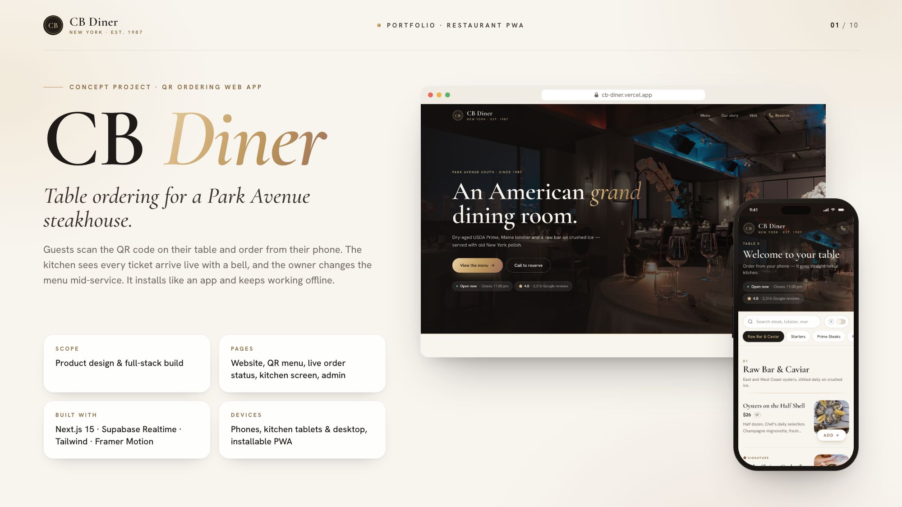

# CB Diner — table-ordering PWA for a Park Avenue steakhouse

**Live site: [cb-diner.vercel.app](https://cb-diner.vercel.app)** · [Table menu](https://cb-diner.vercel.app/menu?table=5) · [Staff sign-in](https://cb-diner.vercel.app/staff/login)



An installable, mobile-first web app for **CB Diner**, a (fictional) prime steakhouse and raw bar on Park Avenue South, New York. Guests scan the QR code on their table, browse the menu, and order from their phone. The kitchen sees orders arrive live, with a bell. The owner edits dishes, prices, photos and availability from an admin screen.

> Demo project by OVIOWEB. All restaurant details, reviews and orders are demo data. Phone numbers use the fictional 555-01xx range.

## Features

**Guest table menu (`/menu?table=5`)**

- The table number comes from the QR code URL and is kept for the visit. Guests without a table get “Pickup / bar”.
- The menu has seven sections, a sticky section bar that follows the scroll, and a desktop side rail.
- You can search dishes instantly and turn on a Vegetarian filter.
- Each dish shows a photo, price in **$**, dietary marks (**V** vegetarian, **VG** vegan, **GF** gluten-free) and labels (Signature, Chef’s selection, For the table, Seasonal, New).
- Tapping a dish opens a sheet with a large photo. Sold-out dishes stay visible but greyed out.
- The cart is a bottom sheet on phones and a side panel on desktop. It keeps quantities, the table, the guest's name and a note for the kitchen (steak temperature, allergies). The cart survives refreshes.
- **Place order** saves the order (to Supabase, or the demo store). Prices are always recalculated on the server, and if a dish has just sold out it is removed with a message.
- **Send on WhatsApp** opens `wa.me` with the order prefilled. It still works when the network is too weak to place the order.
- The live order page polls until the order is served. It also offers a “Send a copy on WhatsApp” button and an “Order more” link.

**Kitchen screen (`/kitchen`)**

- Three columns, **New → Firing → Served**, become tabs on phones.
- In live mode it updates through **Supabase Realtime** (`postgres_changes` on `orders`, limited by row-level security). It also refetches every 30 s as a safety net.
- New orders ring a synthesised bell through the Web Audio API (no audio file), vibrate the device, flash the ticket and show the count in the tab title.
- Ticket timers turn amber after 10 minutes and red after 20. The screen stays awake while sound is on, using the Screen Wake Lock API.
- Each ticket has one-tap Start, Mark served, Undo and Cancel (with confirmation). Updates are optimistic and roll back if the save fails.
- Without Supabase keys the board polls every 3 s and updates instantly between tabs in the same browser (BroadcastChannel). The in-memory store also sends in a new table order every one to two minutes while staff screens are open, so the bell can be seen live.

**Admin (`/admin`)**

- An overview shows orders today, sales, the average check, how many dishes are sold out, and the latest orders.
- The dish list has search and section filters, and a one-tap **Sold out** switch per dish (optimistic).
- You can add, edit or delete a dish: name, description, section, price, vegetarian, labels and availability.
- Photos are uploaded in the browser. They are center-cropped and re-encoded to a ~60 KB WebP plus a square thumbnail *before* upload, with a JPEG fallback for Safari. They are stored in Supabase Storage.
- **Table QR codes**: a printable card for every table, each linking to `/menu?table=N`.

**Website (`/`)**

- Editorial landing page with signature dishes, how table ordering works, the restaurant's story, opening hours (today highlighted, an “Open now / Closes 10:30 pm” status in New York time) and Call / WhatsApp / Directions buttons.
- The Google Map loads on tap, so cheap phones don't download ~1 MB of map scripts up front.
- A “Write a Google review” link uses your Place ID.
- SEO: metadata, Open Graph image, `Restaurant` JSON-LD, sitemap and robots.

**PWA**

- Web app manifest with icons, a maskable icon, shortcuts and screenshots. Android generates its splash screen from the manifest. iOS gets `apple-touch-startup-image` splash screens for eight iPhone sizes.
- Service worker (`/sw.js`, versioned per build):
  - Guest pages are network-first with a 4 s timeout, then fall back to the cache, then to `/offline`.
  - Hashed assets are cache-first.
  - Dish photos are stale-while-revalidate.
  - Staff pages and the API are never cached.
  - The menu works offline after a single visit.
- Install prompt: the native prompt on Android/Chrome, and a Share → “Add to Home Screen” hint on iOS. It appears on the order page and the home page, and can be dismissed for 7 days.

**Fast on cheap phones**

- Photos are self-hosted, pre-sized WebP: menu thumbnails are ~10 KB each and lazy-loaded.
- Off-screen sections use `content-visibility`.
- Framer Motion loads its features lazily (`LazyMotion`), and the table picker is a native `<select>`.
- Toasts and Realtime code load only on staff screens. The guest menu's first load is ~190 kB of JS (gzip).

## Stack

Next.js 15 (App Router, TypeScript) · Tailwind CSS v4 · shadcn/ui (Radix) · Framer Motion · Supabase (Postgres, Auth, Storage, Realtime) · Zod · `qrcode` · Playwright (screenshots and asset generation).

## Getting started

```bash
npm install
cp .env.example .env.local   # every value is optional
npm run dev                   # http://localhost:3000
```

With no Supabase keys the app runs in **demo mode**:

- An in-memory store is seeded with the menu and tonight's orders.
- Staff sign in with one tap on `/staff/login` (Kitchen staff or Owner).
- Uploads are kept as data URLs.

Demo data resets whenever the server restarts (on Vercel, each serverless instance has its own copy).

Set `NEXT_PUBLIC_DEMO_TIME=19:40` to make the demo look like dinner service at any hour of the day. Leave it empty for a real restaurant.

### Going live with Supabase

1. Create a Supabase project and run [`supabase/schema.sql`](supabase/schema.sql) in the SQL editor. It creates:
   - the tables, RLS policies and an `is_staff()` helper
   - the Realtime publication for `orders`
   - the public `menu-photos` storage bucket
2. Add `NEXT_PUBLIC_SUPABASE_URL`, `NEXT_PUBLIC_SUPABASE_ANON_KEY` and `SUPABASE_SERVICE_ROLE_KEY` to `.env.local`.
3. `npm run seed` loads the menu.
4. Create staff accounts in **Authentication → Users** and turn off public sign-ups. Then give each one a role:
   ```sql
   insert into public.staff (user_id, name, role) values ('<auth-user-id>', 'Maria', 'admin');   -- or 'kitchen'
   ```
5. Set `NEXT_PUBLIC_SITE_URL` to your domain *before* printing the table QR codes from `/admin/qr`.

How the security fits together:

- The browser never writes to the database. Orders and menu edits go through server routes and actions that check the staff session and use the service-role key.
- The browser reads only the public menu, plus the order feed for signed-in staff, which RLS enforces for Realtime.

### Restaurant details

Edit [`lib/restaurant.ts`](lib/restaurant.ts) for the name, address, hours and tax note. These are set through environment variables instead:

- `NEXT_PUBLIC_RESTAURANT_PHONE`
- `NEXT_PUBLIC_WHATSAPP_NUMBER` (digits, with country code)
- `NEXT_PUBLIC_TABLE_COUNT`
- `NEXT_PUBLIC_MAPS_QUERY` and an optional `NEXT_PUBLIC_GOOGLE_MAPS_EMBED_KEY`
- `NEXT_PUBLIC_GOOGLE_PLACE_ID`, which powers the review link

The demo menu lives in [`lib/demo/seed.ts`](lib/demo/seed.ts).

## Scripts

| Command | What it does |
| --- | --- |
| `npm run dev` | Dev server. The service worker is off unless `NEXT_PUBLIC_SW_DEV=1`. |
| `npm run build` / `npm start` | Production build and server. |
| `npm run lint` | ESLint, including `no-console`: app code logs through `lib/log.ts`, which only prints debug and warning output in development or with `NEXT_PUBLIC_DEBUG=1`. |
| `npm run seed` | Loads the demo menu into Supabase. |
| `npm run assets` | Re-renders icons, iOS splash screens, the favicon and the OG image with Playwright. |
| `npm run screenshots` | Walks the full flow against a running server and saves 21 screens at 1440×900 and 390×844 to `/screenshots`. Set `SCREENSHOT_BASE_URL`, e.g. `http://localhost:3000`. |

## Deploy to Vercel

1. Import the repository and add the environment variables from `.env.example`.
2. Deploy. The app reads `VERCEL_PROJECT_PRODUCTION_URL` when `NEXT_PUBLIC_SITE_URL` isn't set.

If you skip the Supabase keys, the deployment runs in demo mode.

## Project layout

```
app/
  page.tsx                 website
  menu/                    guest table menu
  order/[id]/              live order status
  kitchen/                 kitchen board (staff)
  admin/                   overview, dish editor, table QR codes (owner)
  staff/                   sign-in + actions
  api/orders/              place order, kitchen feed, status updates
  sw.js/route.ts           service worker
  manifest.ts, offline/    PWA
components/                menu, cart, kitchen, admin, pwa, site
lib/
  db/                      Repo interface, demo store, Supabase repo
  restaurant.ts, hours.ts  public details + open/closed logic
supabase/schema.sql
scripts/                   seed, assets, screenshots
```

## Portfolio deck

`portfolio/slide-01.png … slide-10.png` (2000×1125) and `portfolio/upwork.md` are built from real screens:

```bash
NEXT_PUBLIC_SITE_URL=https://cb-diner.vercel.app npm run build && npm start -- -p 3117
PORTFOLIO_BASE_URL=http://localhost:3117 npx tsx portfolio/source/capture.ts   # 1440×900 @2x, 390×844 @3x + marker anchors
npx tsx portfolio/source/render.ts                                              # HTML slides → PNG
```

Rebuild without the `NEXT_PUBLIC_SITE_URL` override afterwards. `portfolio/` is excluded from Vercel deploys.

Photo credits are in [IMAGE_CREDITS.md](IMAGE_CREDITS.md) (all Unsplash License).
